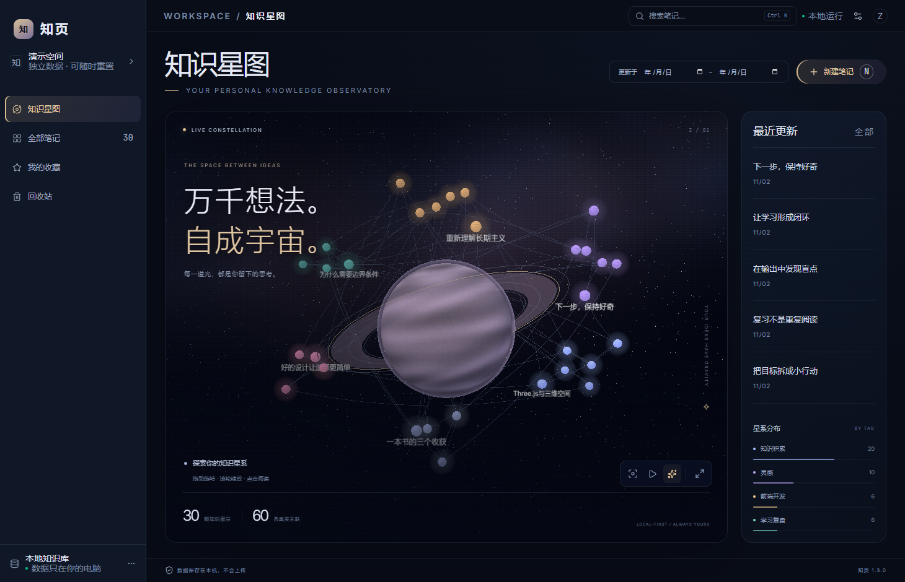
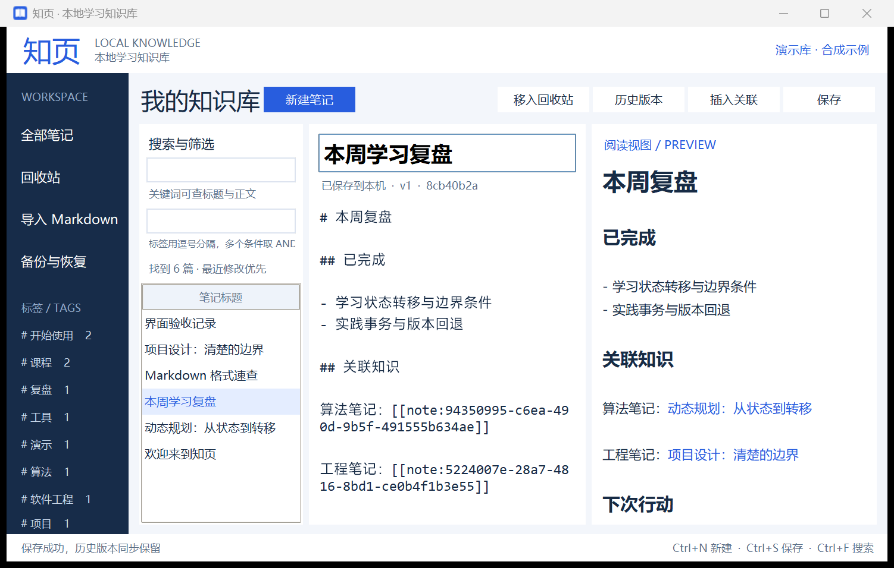

# 知页 · 本地学习知识库

## 知识星图 1.3 · 沉浸式星际界面



新增React/Three.js深色知识星图与Windows WebView2桌面入口，节点/连线读取同一SQLite库。新建、搜索、关联、自动保存、版本、回收站和备份导出均调用已有业务模块；原Tk入口仍保留。

新版提供程序生成的星云与星体材质、光环、大气层、真实笔记节点、可切换柔光、自动巡航和一键沉浸展示（Esc 退出）。主星体与背景星光是视觉装饰，计数只包括实际笔记和实际关联。[视觉设计、复用来源与演示说明](docs/A_沉浸星图视觉升级.md)。

**[下载最新正式版](https://github.com/zemengzero/MSGA/releases/latest)**：完整解压对应版本 Windows ZIP，打开 `软件/Start-Demo.cmd` 展示星图，或打开 `软件/Start-Personal.cmd` 使用正式笔记库。需要 Windows x64 和 Edge WebView2 Runtime，无需安装 Python/Node，图形资源和字体随程序离线打包。

A 的界面与 C 的真实搜索实现已接入：更新时间按北京时间筛选，截止日期包含当天；关键词和标签维持 AND 规则；摘要高亮、笔记内查找与命中跳转保留。当前源码基于已合入 B 恢复审计的主干，恢复接口与数据库沿用既有实现。早期 A+C 交接记录见 [AC 集成说明](docs/AC_INTEGRATION.txt)，其中 B 未接入的描述属于 1.1 阶段历史状态。

源码运行：在frontend执行`npm ci`、`npm run build`，回根目录执行`.venv/Scripts/python.exe -m zhiyeteam.galaxy --demo`。打包使用`python tools/build_galaxy.py`，实体exe检查用`python tools/frozen_galaxy.py`；Windows需要Edge WebView2 Runtime。发行exe不要求Python/Node。

给B/C/D：[新版界面对接约定](docs/新版界面_BCD对接说明.md)。本次只更换视觉组件与样式，保留 B/C 模块与对接协议。A 早期交付见[知识星图说明](docs/A_知识星图交付说明.md)，本次新增代码定位见[沉浸星图说明](docs/A_沉浸星图视觉升级.md)；各阶段历史测试数量不混用，当前发行实测记录随发布包提供。

用于软件工程团队验收的 Windows 桌面程序：记录 Markdown 笔记，按关键词和标签找回知识，用稳定 UUID 关联笔记，通过历史版本、回收站和完整备份保护内容。

团队版使用 Python + SQLite 业务层，正式星图界面为 React + Three.js + Windows WebView2，保留 Tkinter 旧入口。前两次实验的 .NET/Markdown 文件方案属于设计探索；本项目独立维护团队需求基线与实际实现说明。



## 当前笔记内查找 / Find in current note

当前源码支持：打开笔记详情并保持“阅读”模式，点击“笔记内查找”，输入关键词即可统计、高亮并定位正文中的匹配。支持中文、ASCII 大小写、emoji、粘贴多行、跨 Markdown 节点和重叠命中；上下箭头循环跳转，Enter / Shift+Enter 切换，Esc 关闭。查找不修改正文或触发保存。

Use **Find in note** in the read-only detail view; all matches and the active hit are highlighted, with wraparound navigation and note-body scrolling. This feature is preserved in the 1.3 source and included when building the 1.3 executable.

操作、验收清单、演示及限制见 [四步验收与交接](docs/C_笔记内查找_第四步验收与演示.md)。1.1 旧版 EXE 不包含后续新增能力，体验时请核对下载版本。

## 交付与演示

- [Windows 最新正式发布](https://github.com/zemengzero/MSGA/releases/latest)
- [保留的 v1.0.0 历史报告与旧程序](https://github.com/zemengzero/MSGA/releases/tag/v1.0.0)
- [四人分工与每次提交安排](docs/团队分工与提交计划.md)
- [D今晚的仓库统筹操作单](docs/D_仓库统筹操作单.md)
- [8分钟现场演示步骤](docs/现场演示步骤.md)
- [功能与代码定位](docs/功能与代码定位.md)
- 原始实际测试：`reports/test_results.json`、`reports/frozen_smoke.json`；尚未完成的真人反馈不写成已完成。

本项目使用小组已有的公开仓库`zemengzero/MSGA`，验收日期已确认2026年11月2日。掌握全员GitHub链接的同学担任D，负责协调协作权限、PR合并、发布和证据汇总；其他成员各用本人账号提交。

## 开发运行

```powershell
python -m venv .venv
.\.venv\Scripts\python.exe -m pip install -e .
cd frontend
npm ci
npm run build
cd ..
.\.venv\Scripts\python.exe -m zhiyeteam.galaxy --demo
```

正式运行不带 `--demo`，默认将数据库保存到当前用户的本地应用数据目录。演示模式使用独立数据库，不覆盖正式笔记。

旧 Tk 界面开发入口为 `python -m zhiyeteam --demo`。正式演示请使用上面的星图入口或发行包中的 `Start-Demo.cmd`。

发布ZIP中的独立exe已在本机启动并验证真实窗口/保存。另一台未安装Python的机器仍需按D成员任务进行实测；本项目没有把本机检查冒称所有Windows版本兼容。

## 验证

```powershell
.\.venv\Scripts\python.exe -m unittest discover -s tests -v
```

## 团队提交约定

当前账号建立的基线不替代四位成员的贡献。每位成员使用自己的 GitHub 账号，在功能分支上实际修改、运行测试并提交，PR 中写明功能、代码位置、验证结果和已知限制。分工及逐次提交安排见 `docs/团队分工与提交计划.md`。

报告只记录实际执行的测试和反馈。用户反馈待真人试用后填写，不能把合成演示数据当作调研。最终要求以老师最新课堂说明为准。

## 重新生成报告

安装 `requirements-docs.txt` 后运行 `python tools/build_reports.py`；报告按当前源码AST提取函数位置，并读取真实测试JSON。PDF渲染使用Windows上的Chrome，已经生成的Word/PDF在发布包中，无需为了阅读文档安装这些开发依赖。

## 官方技术参考

- [Python SQLite在线备份](https://docs.python.org/3.13/library/sqlite3.html#sqlite3.Connection.backup)
- [PyInstaller打包说明](https://pyinstaller.org/en/stable/operating-mode.html)
- [GitHub提交邮箱与归属](https://docs.github.com/en/account-and-profile/concepts/email-addresses)

第三方运行库许可随发布文件的说明保留；本仓库未另行授予开源许可证。
