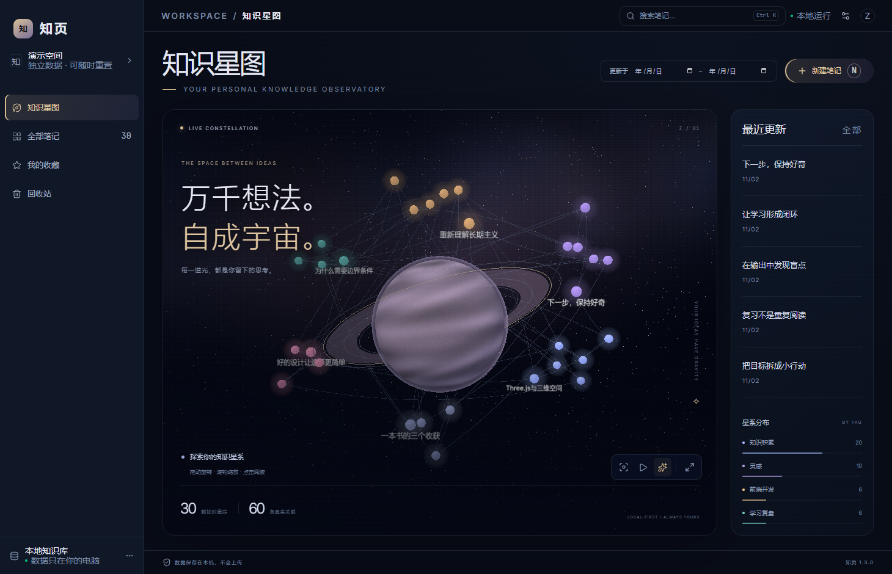
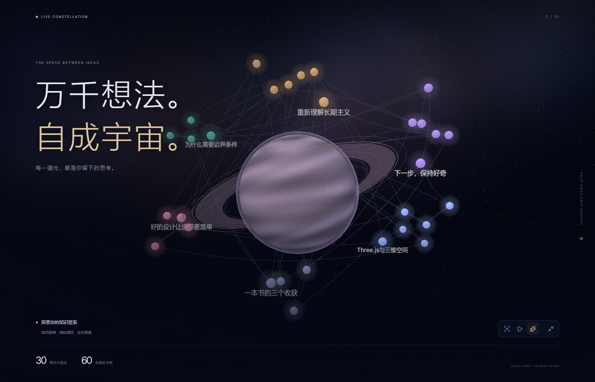

# 知页 1.3：沉浸星图视觉升级

本次目标是增强前端的视觉表现。基于 `40aeea9bcde07be2930689f751428877297fcd03`（已合并 B 的恢复审计，以及 C 的摘要高亮和笔记内查找）开发，保留最新主干的 React/shadcn 界面基础、保存流程、业务接口与数据库。

## 实际改动

- 三维主舞台：程序生成的星云背景、2300 个装饰星光、带纹理的主星体、光环、大气层和受灯光影响的笔记节点。
- 笔记与关联：继续读取 `GalaxyAPI.snapshot` 的有效笔记及真实 UUID 关联；前端按标签布置星簇，节点点击仍打开原详情。
- 光效与镜头：Three.js `UnrealBloomPass` 柔光可关闭，自动巡航可暂停，支持恢复视角和全窗口沉浸展示。
- 界面：深空蓝、暖金色和玻璃面板；保留搜索、日期、列表、阅读/编辑、查找、历史、回收站、导入导出和备份入口。
- 兼容：不改变 B/C 源码、Schema、API action 或搜索规则；多工作目录的浏览器测试显式指定各自 `src`，避免误跑共享虚拟环境指向的旧代码。

中央主星体、光环和背景星光是视觉装饰，不计入笔记节点。真实节点/关联数量来自 `snapshot.graph`，遵守已有 150 节点显示上限；不宣称新增了全库图算法、AI 或语义推理。

## 代码定位

| 文件 | 职责 |
| --- | --- |
| `frontend/src/Observatory.jsx` | 独立三维组件、纹理生成、真实节点映射、镜头与光效控制、图形降级和资源释放 |
| `frontend/src/observatory.css` | 深空主题、主舞台、沉浸模式、面板、阅读与查找的颜色适配 |
| `frontend/src/main.jsx` | 接入新组件，沿用原状态和业务操作；标签分布使用真实标签计数 |
| `frontend/src/NoteFindPanel.jsx` / `noteFindDOM.js` | C 的笔记内查找与高亮，原实现保留 |
| `src/zhiyeteam/restore_audit.py` | B 的恢复审计，原实现保留 |
| `tools/build_galaxy.py` | 打包全部前端资源及改编代码的许可原文，记录源文件哈希 |

纹理与几何在本机生成，字体由 npm 包本地打包，不从 CDN 下载图片、字体或脚本。图形上下文失效时显示降级提示，仍可通过全部笔记阅读与编辑；编辑抽屉打开时暂停背景动画。节点视觉缓存随改名刷新，移除节点时释放对应资源。柔光可关闭以降低负载。

## 学习与复用来源

1. [CosmoGraph](https://github.com/n1ghtmare-dev/obsidian-cosmograph)：MIT。参考星球、光晕和沉浸场景；实际改编了 `src/graph/SphericalGraph.ts` 的确定性随机函数及径向 Canvas 光晕辅助技术。原始版权、MIT 全文和改编范围保存在 `third_party/cosmograph/`，Windows EXE 内嵌此目录，发行包另附许可原文。
2. [react-force-graph 官方示例](https://github.com/vasturiano/react-force-graph/tree/master/example)：MIT。参考镜头移动、高亮与 Bloom 的公开接口。图谱库与 Three.js 保留原依赖和许可。
3. [Spherical Knowledge Graph](https://github.com/IronMind15/spherical-knowledge-graph)：参考其聚焦与浮层组织方式，本次未复制其实现。

本项目没有把上游图形库或上述改编辅助代码当作从零原创，也未搬入整个 Obsidian 插件或改变笔记文件解析方式。声明的设计与实现贡献是本项目的视觉整合、场景材质/布局、React 状态适配和原桌面业务衔接。

## 实际演示

1. 用独立演示数据打开 Windows EXE，展示真实笔记围绕主星体的场景。
2. 点击右下角“沉浸展示”，切换柔光，开启/暂停巡航，按 Esc 回到界面。
3. 点击笔记或最近更新进入原详情，展示 C 的查找/高亮、编辑保存，再关闭详情返回星图。
4. 打开“数据与备份”展示 B 的恢复入口；真实恢复前按原流程核对备份和保护副本。

浏览器截图来自实际运行，不是设计稿。本次本机已执行并通过 117 项 Python、17 项查找单元、19 项浏览器流程；Windows 实体程序结果与原始证据随发行包提供。其他电脑的性能与 WebView2 环境仍需现场实际确认。

