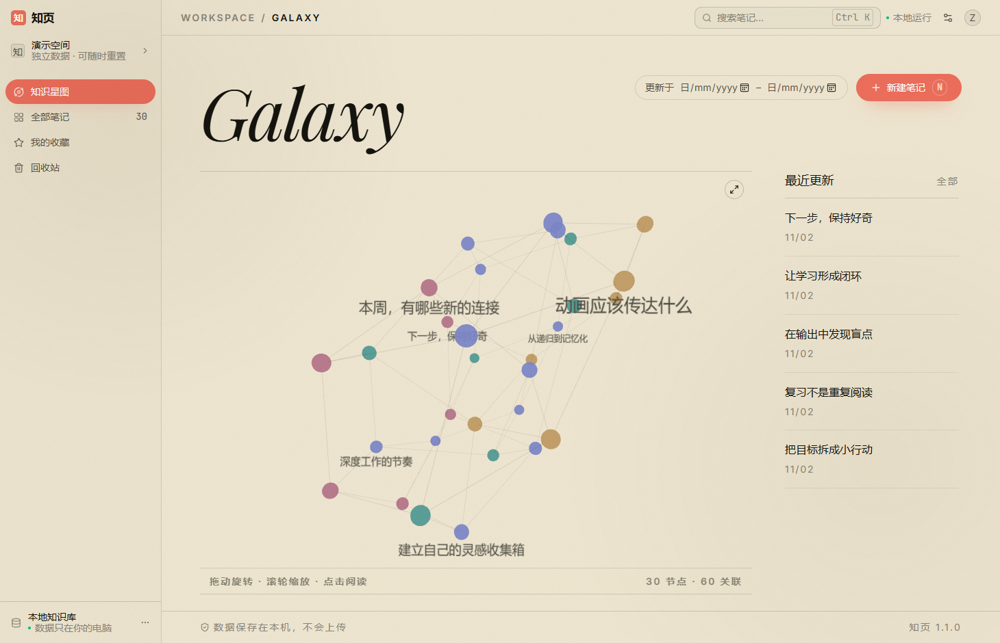

# 历史版本 1.2：原纸墨界面说明

> 以下保留主干 2ae0c87a975474ef11b62af772b5eff726c05c65 的 README 原文与固定版本链接；当前 1.3 界面及运行说明见[项目首页](../README.md)。1.2 的视觉、文件名与测试状态属于该阶段记录。

# 知页 · 知识星图 v1.2.0

本地优先的 Markdown 笔记与知识星图。Windows 桌面程序，数据只存本机 SQLite，不联网、不需要账号。



## 1.2.0 改了什么

界面整体重做，业务逻辑未动：

- **纸墨视觉**：暖纸底 `#efe7d2`、墨黑 `#15140f`、珊瑚红 `#ed6f5c`；Playfair 斜体标题、Inter Tight 正文、JetBrains Mono 数字。
- **组件化**：Tailwind 4 + shadcn 原语（Button / Input / Dialog / Command / Sonner）替换原来的手写 `style.css`（该文件已删除）。
- **无卡片布局**：星图铺满版面，右栏只留「最近更新」列表；列表行只有标题、日期、版本。
- **命令面板**：`Ctrl/Cmd + K` 打开，搜索走真实索引，可直接跳转笔记或执行新建、备份等动作。
- **最小字号 14px**，不再使用 10px 级别的小标签、小角标。

保留能力：笔记内查找与高亮、命中摘要高亮、双链图谱、版本历史、回收站、备份/恢复、Markdown 导入与 HTML 导出。

## 下载与运行

**[最新正式版 v1.2.0](https://github.com/zemengzero/MSGA/releases/tag/v1.2.0)**，解压后：

- `software/Start-Demo.cmd` —— 演示库，随便试，不影响个人数据
- `software/Start-Personal.cmd` —— 正式库

需要 **Windows x64** + **Edge WebView2 Runtime**（Win11 自带），不需要安装 Python 或 Node，前端资源已离线打进 exe。

## 从源码运行

```powershell
python -m venv .venv
.\.venv\Scripts\python.exe -m pip install -e .

cd frontend
npm ci
npm run build
cd ..

# 演示库
.\.venv\Scripts\python.exe -m zhiyeteam.galaxy --demo
# 正式库（数据在 %LOCALAPPDATA%\ZhiYeTeam\personal）
.\.venv\Scripts\python.exe -m zhiyeteam.galaxy
```

旧的 Tk 入口仍在：`python -m zhiyeteam --demo`。

## 结构

| 层 | 位置 | 说明 |
|---|---|---|
| 业务 | `src/zhiyeteam/` | SQLite 存储、搜索、双链、版本、备份、导入导出（Python 3.12+） |
| 界面 | `frontend/src/` | React 19 + Vite 8 + Tailwind 4；`main.jsx` 是应用外壳，`components/ui/` 是 shadcn 原语 |
| 桌面 | `src/zhiyeteam/galaxy.py` | 本地 HTTP 服务 + WebView2 窗口，只监听 127.0.0.1，带 token 校验 |
| 打包 | `tools/build_galaxy.py` | `npm run build` + PyInstaller 单文件 exe |
| CI | `.github/workflows/` | `tests.yml`、`galaxy-frontend.yml`、`package-windows.yml` |

## 验证

```powershell
# 后端
.\.venv\Scripts\python.exe -m unittest discover -s tests -v

# 前端
cd frontend
npm run test:note-find   # 笔记内查找纯函数单测
npx playwright test      # 浏览器端到端
```

当前基线：后端 91 项、浏览器端到端 17 项、笔记内查找单测 17 项，全部通过；打包产物的 sha256 记录在 `reports/A/galaxy-build.json`，并与 Release 附带的 `galaxy-v1.2.0-checks.json` 一致。

## 发版流程

1. 合并到 `main`
2. Actions → **package-windows** → Run workflow
3. 下载 artifact（`ZhiYeGalaxy.exe` + `galaxy-build.json`）
4. 按 `software/`、`source/`、`evidence/`、`docs/` 结构打包 zip，创建 Release

## 已知限制

- 侧栏标签筛选入口在 1.2.0 的改版中被移除（标签仍可编辑，搜索仍支持标签参数），是否恢复待定。
- `galaxy-ui-and-adapter` 在慢 runner 上有偶发时序失败（同一 commit 重跑可过），未加 `retries`。
- 笔记内查找只在「阅读」模式可用；编辑模式会隐藏查找面板。

## 相关文档

- [笔记内查找四步验收](https://github.com/zemengzero/MSGA/blob/2ae0c87a975474ef11b62af772b5eff726c05c65/docs/C_笔记内查找_第四步验收与演示.md)
- [摘要高亮扩展说明](https://github.com/zemengzero/MSGA/blob/2ae0c87a975474ef11b62af772b5eff726c05c65/docs/C_摘要高亮拓展说明.md)
- [AC 集成说明](https://github.com/zemengzero/MSGA/blob/2ae0c87a975474ef11b62af772b5eff726c05c65/docs/AC_INTEGRATION.txt)
- [新版界面 BCD 对接说明](https://github.com/zemengzero/MSGA/blob/2ae0c87a975474ef11b62af772b5eff726c05c65/docs/新版界面_BCD对接说明.md)
- [团队分工与提交计划](https://github.com/zemengzero/MSGA/blob/2ae0c87a975474ef11b62af772b5eff726c05c65/docs/团队分工与提交计划.md)
- [8 分钟现场演示步骤](https://github.com/zemengzero/MSGA/blob/2ae0c87a975474ef11b62af772b5eff726c05c65/docs/现场演示步骤.md)

## 许可

第三方运行库许可见发布包内的许可说明；本仓库本身未另行授予开源许可证。
